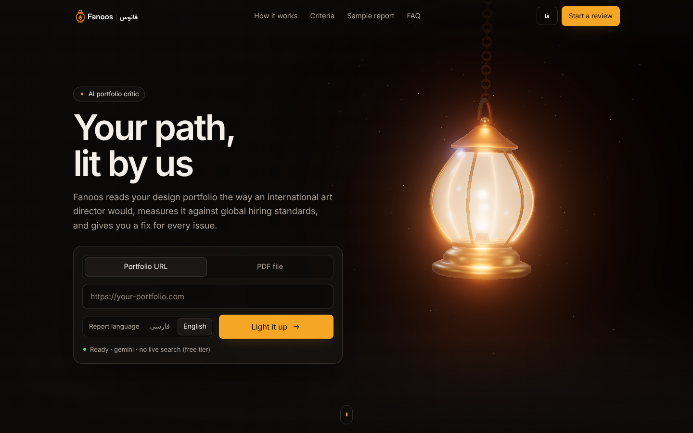
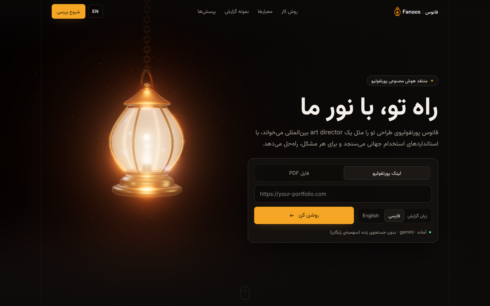
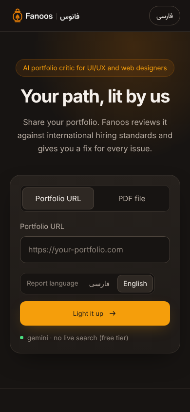
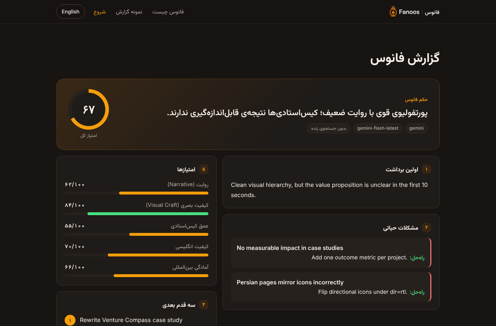

<div align="center">

<picture>
  <source media="(prefers-color-scheme: dark)" srcset="assets/logo-full.svg">
  
</picture>

**A bilingual (Persian / English) AI portfolio critic and career coach for UI/UX and web designers.**

[](https://github.com/zahednegar-hub/fanoos/actions/workflows/ci.yml)


[What it is](#what-it-is) · [Quickstart](#quickstart) · [Web UI](#web-ui) · [CLI](#cli-reference) · [n8n](#n8n) · [Roadmap](#roadmap) · [فارسی](#فارسی)

</div>

<p align="center"></p>

## What it is

Fanoos (فانوس, *"lantern"*) reviews a designer's portfolio the way an international art director
would, then tells you exactly what to fix. Give it a portfolio URL or PDF and you get:

- a **one-line Persian verdict**
- **First Impression**: the 10-second recruiter test
- **Critical Issues**: the dealbreakers, each with a fix
- **Quick Wins**: fixes that take under an hour
- **Next 3 Actions**: prioritised
- **Scores** from 0 to 100 on Narrative, Visual Craft, Case Study Depth, English Quality and
  International Readiness

It comes as a **web app**, a **CLI** (`fanoos review …`), a **Python library**, a **JSON API** and
ready-made **n8n workflows**. The name means lantern: it lights the path; it never walks it for you.

## Why it exists

Many Iranian and non-native-English designers are talented but lose international jobs,
scholarships and remote clients on presentation: case studies without measurable impact, English
that reads as translated, Persian pages with broken RTL. Fanoos reviews against international hiring
standards (case study structure, visual hierarchy, typography, WCAG accessibility, RTL/LTR
correctness), checks current trends with live web and X search on xAI, and never criticises without
a solution. It never invents metrics, clients or data either.

## Architecture

```
   Browser (web/)          Terminal              n8n / any HTTP client
   3D lantern + form       fanoos review …       POST /api/review
          │                      │                       │
          ▼                      │                       ▼
  ┌───────────────────┐          │          ┌────────────────────────┐
  │ server.py (FastAPI)│◀─────────┼──────────│ n8n/*.json workflows   │
  │ /  /api/review     │          │          └────────────────────────┘
  │ /health /api/providers        │
  └─────────┬─────────┘          │
            ▼                    ▼
  ┌──────────────────────────────────────────────────────────────┐
  │ fanoos/                                                       │
  │  sources.py    URL → page text · PDF → text (pypdf)           │
  │  agent.py      Fanoos: one system message = persona (verbatim) │
  │                + output format (+ "no live search" if needed)  │
  │  providers.py  xai · gemini · groq  (OpenAI-compatible)        │
  │  tools.py      web_search + x_search (xAI only)                │
  │  review.py     reply → Review (JSON summary, Markdown fallback)│
  └──────────────────────────────┬───────────────────────────────┘
                                 ▼
        xAI Responses API + Agent Tools   │   Gemini / Groq Chat Completions
        (live web and X search)           │   (model knowledge, «بدون جستجوی زنده»)
```

| Path | Responsibility |
|---|---|
| `fanoos/system_prompt.py` | The validated persona, verbatim; output-format and no-live-search instructions are appended separately |
| `fanoos/agent.py` | `Fanoos` class: builds the request, streams the reply, maps API errors |
| `fanoos/providers.py` | Provider registry and selection (`FANOOS_PROVIDER`, else the first key present) |
| `fanoos/tools.py` | xAI Agent Tools config (`web_search`, `x_search`) |
| `fanoos/review.py` | `Review` dataclass and the parser for the model's output |
| `fanoos/sources.py` | Reads portfolio input from a URL or a PDF |
| `fanoos/cli.py` | The `fanoos` command |
| `fanoos/server.py` | FastAPI app: web UI, JSON API, upload limits, private-URL guard |
| `web/` | The web UI: plain HTML/CSS/JS, no build step; Three.js lantern in `web/static/lantern3d.js` |
| `n8n/` | Importable n8n workflows (webhook, optional Telegram bot) |

## Quickstart

Requires Python 3.10+ on macOS, Linux or Windows.

```bash
git clone https://github.com/zahednegar-hub/fanoos.git
cd fanoos
python -m venv .venv
source .venv/bin/activate          # Windows: .venv\Scripts\activate
pip install -e .
```

Then set **one** provider key. Keys are read **only** from the environment (or a local `.env`,
which is git-ignored); they are never hard-coded, stored or logged. Copy `.env.example` to `.env`
to start.

| Provider | Key | Get it | Live search | Cost |
|---|---|---|---|---|
| **xAI Grok** | `XAI_API_KEY` | [console.x.ai](https://console.x.ai) | Web + X | Paid |
| **Google Gemini** | `GEMINI_API_KEY` | [aistudio.google.com/apikey](https://aistudio.google.com/apikey) | No | Free tier |
| **Groq** | `GROQ_API_KEY` | [console.groq.com/keys](https://console.groq.com/keys) | No | Free tier |

**xAI** (recommended: live web and X search before trend advice)

```bash
export XAI_API_KEY=your_xai_key          # Windows PowerShell: $env:XAI_API_KEY = "your_xai_key"
fanoos review https://your-portfolio.com
```

**Gemini** (free)

```bash
export GEMINI_API_KEY=your_gemini_key
fanoos review https://your-portfolio.com
```

**Groq** (free)

```bash
export GROQ_API_KEY=your_groq_key
fanoos review https://your-portfolio.com
```

If several keys are set, Fanoos picks xAI, then Gemini, then Groq. Override with
`FANOOS_PROVIDER=gemini` or `--provider gemini`. Run `fanoos providers` to see what is configured.

> **About "free".** Gemini and Groq free tiers have per-minute and per-day request limits. They are
> fine for trying Fanoos and for demos. For real clients or regular use, switch to xAI (which also
> adds live search) or a paid plan. Default models: `grok-4-1-fast-reasoning`, `gemini-flash-latest`
> and `openai/gpt-oss-120b`; override any of them with `FANOOS_MODEL` or `--model`.

### As a library

```python
from fanoos import Fanoos, load_source

agent = Fanoos()  # picks the provider from the environment
review = agent.review(load_source("https://your-portfolio.com"), language="en")

print(review.verdict)
for issue in review.critical_issues:
    print(issue.issue, "→", issue.fix)
print(review.scores, review.overall_score, review.provider, review.live_search)
```

See [`examples/review_example.py`](examples/review_example.py) for a streaming example.

## Web UI

```bash
uvicorn server:app --port 8000
```

Open <http://localhost:8000>. The page is Persian (RTL) by default with an English (LTR) toggle.

- A **3D lantern** (Three.js, procedural, no external assets) stands beside the review form. Its
  flame works harder while a review runs and flares when the report is ready; it follows the pointer
  and the page scroll.
- Paste a portfolio **URL** or upload a **PDF** (up to 15 MB), choose the report language, and the
  report renders with animated score bars.
- A **sample report** is built in, so the page is complete without any API key.
- Accessibility: WCAG 2.1 AA (axe: 0 violations in Persian and English, desktop and mobile), keyboard
  and screen-reader friendly, `prefers-reduced-motion` respected.
- Performance: the 3D scene pauses off-screen and in hidden tabs, drops shadows, bloom and resolution
  on weak GPUs, and falls back to a static mark without WebGL.

| Persian, desktop | English, mobile | Report |
|---|---|---|
|  |  |  |

### HTTP API

| Method | Path | Description |
|---|---|---|
| `GET` | `/health` | Status, version and selected provider (never keys) |
| `GET` | `/api/providers` | Which providers are configured |
| `POST` | `/api/review` | JSON `{"url": "...", "lang": "fa"\|"en", "focus": "..."}`, or multipart with `url` or `file` (PDF) |

Errors return JSON `{"error": "English\nPersian", "type": "..."}` with a matching status code
(400 bad input or blocked URL, 413 too large, 429 rate limit, 502 provider error, 503 no key
configured or all review slots busy). Interactive docs at `/docs` exist only with
`FANOOS_ENV=development`; production (the default) disables them.

## Deploy on cPanel

Fanoos runs on ordinary cPanel shared hosting with **Setup Python App** (Passenger or LiteSpeed):
no Docker, root, SSH, Node.js or database needed.

```bash
python tools/build_cpanel_package.py      # → dist/fanoos-v0.3.0-cpanel.zip + .sha256
```

The ZIP extracts to `fanoos-app/` with a Passenger entry point (`passenger_wsgi.py`, entry point
`application`, FastAPI adapted to WSGI with `a2wsgi`), pinned `requirements.txt`, `.env.example`
and two guides: [`README_DEPLOY.md`](deployment/cpanel/README_DEPLOY.md) (English) and
[`DEPLOY_CPanel_FA.md`](deployment/cpanel/DEPLOY_CPanel_FA.md) (Persian, step by step for beginners).

Production settings (all optional, safe defaults; see `deployment/cpanel/.env.example`):
`FANOOS_RATE_LIMIT` (default `10/hour` per visitor IP), `FANOOS_MAX_CONCURRENT` (`2`),
`FANOOS_TIMEOUT` (`180` s), `FANOOS_MAX_UPLOAD_MB` (`15`), `FANOOS_ENV` (`production`),
`FANOOS_TRUST_PROXY` (`0`), `FANOOS_LOG_LEVEL` (`INFO`).

## CLI reference

```
fanoos [--version] [--help]
fanoos providers
fanoos review <target> [options]
```

| Option | Description |
|---|---|
| `target` | Portfolio URL (`https://…`) or path to a PDF |
| `--provider {xai,gemini,groq}` | AI provider (default: `$FANOOS_PROVIDER`, else the first configured) |
| `--model ID` | Model ID (default: `$FANOOS_MODEL`, else the provider's default) |
| `--lang {fa,en}` | Reply language. Default `fa`; the verdict is always Persian |
| `--focus TEXT` | Extra request, e.g. `"Focus on the Venture Compass case study"` |
| `--json` | Print only the structured review as JSON |
| `--raw` | Print the model's reply unparsed |
| `--no-stream` | Wait for the full reply, then render it as formatted Markdown |
| `--no-fetch` | Don't pre-fetch the URL; let the model open it with web search |
| `--bidi` | Reorder Persian text for terminals without RTL support (`pip install -e ".[bidi]"`) |

**Exit codes:** `0` success · `2` missing or rejected API key · `3` network failure ·
`4` rate limited (429) · `5` other API error · `6` malformed model output · `7` unreadable input.

<details>
<summary>Example terminal output</summary>

```
$ fanoos review https://example-portfolio.com --lang en
🏮 Fanoos is reading https://example-portfolio.com (gemini · gemini-flash-latest) …
        پورتفولیوی قوی با روایت ضعیف؛ کیس‌استادی‌ها نتیجه‌ی قابل‌اندازه‌گیری ندارند.
## 1) First Impression
Clean visual hierarchy, but the value proposition is unclear in the first 10 seconds…

╭──────────────────────── Fanoos · فانوس scorecard ────────────────────────╮
│  Narrative                ████████████░░░░░░░░  62/100                     │
│  Visual Craft             █████████████████░░░  84/100                     │
│  Case Study Depth         ███████████░░░░░░░░░  55/100                     │
│  English Quality          ██████████████░░░░░░  70/100                     │
│  International Readiness  █████████████░░░░░░░  66/100                     │
│  Overall                  █████████████░░░░░░░  67/100                     │
│                                                    بدون جستجوی زنده        │
╰──────────────────────────── gemini · gemini-flash-latest ─────────────────╯
```

*Illustrative output, not a review of a real portfolio.*
</details>

## n8n

Two ready-to-import workflows live in [`n8n/`](n8n/):

- `fanoos-workflow.json`: **Webhook** `POST /fanoos-review` → Fanoos `/api/review` → **Respond to
  Webhook**, passing status codes through.
- `fanoos-telegram-workflow.optional.json`: a Telegram bot that replies to any portfolio link with
  a short Persian review.

Both were tested on n8n 2.45 (import, publish, end-to-end run). Step-by-step guide:
[`docs/n8n.md`](docs/n8n.md).

## Security

- API keys are read only from environment variables (or a local, git-ignored `.env`), never logged,
  never returned by the API, and never shown in the UI.
- Uploaded PDFs are limited to 15 MB and must start with `%PDF`; they are processed in a temporary
  directory and deleted.
- SSRF protection: only http(s); every resolved address must be public (loopback, private,
  link-local/cloud metadata, CGNAT, multicast and reserved ranges are refused); redirects are
  followed manually and every hop is re-checked; the connected peer is verified against DNS
  rebinding; only HTML/text is accepted, up to 3 MB. `FANOOS_ALLOW_PRIVATE_URLS=1` exists for
  local testing only.
- Request bodies are capped while they stream in, so oversized uploads never reach the disk.
- A per-IP rate limit and a concurrency cap protect your AI quota; in production visitors cannot
  choose the provider or model.
- Every response carries a strict Content-Security-Policy (no inline scripts except the hashed
  import map), `X-Frame-Options: DENY`, `nosniff`, a referrer and permissions policy, and HSTS
  over HTTPS. No CORS headers are sent.
- Error messages are redacted for anything shaped like an API key; unexpected errors return a
  generic message and are logged without request bodies or secrets.
- Model output is rendered as text only (no `innerHTML`), so a review cannot inject markup.
- Before publishing, scan for key prefixes with `grep -rE "xa[i]-|AI[z]a|gs[k]_" .` (the brackets
  stop the command from matching itself). It finds nothing in this repository.

## Roadmap

- [x] **v0.1**: CLI and library, URL and PDF input, streamed bilingual report, structured JSON
- [x] **v0.2**: brand, xAI/Gemini/Groq providers, web UI with 3D lantern, HTTP API, n8n workflows
- [x] **v0.3**: production hardening (SSRF, rate limits, CSP) and a tested cPanel/Passenger package
- [ ] **v0.4**: `fanoos polish` for before/after English rewrites of bios and case studies
- [ ] **v0.5**: follow-up re-reviews that compare against a saved previous review
- [ ] **v0.6**: screenshot input, so the model can judge visuals directly
- [ ] **v1.0**: accounts, saved reports and payments on the same core

## Contributing

```bash
pip install -e ".[dev,bidi]"
pytest          # all tests are offline; every provider is mocked
ruff check .
```

Keep the persona in `fanoos/system_prompt.py` verbatim; behaviour changes belong in the appended
instructions or in code. Use [Conventional Commits](https://www.conventionalcommits.org/) and add a
line to `CHANGELOG.md`. The logo is generated by `tools/build_logo.py`.

## Credits and license

[MIT](LICENSE) © 2026 Negar Zahed. Bundled third-party assets: [Three.js](https://threejs.org) (MIT,
`web/static/vendor/three/LICENSE`), [Inter](https://rsms.me/inter/) and
[Vazirmatn](https://github.com/rastikerdar/vazirmatn) (SIL OFL 1.1, `web/static/fonts/`).

---

<div dir="rtl">

## فارسی

**فانوس** یک منتقد دوزبانه‌ی هوش مصنوعی برای پورتفولیوی طراحان UI/UX و وب است. لینک یا PDF پورتفولیو را
می‌دهی و این‌ها را می‌گیری: یک جمله حکم فارسی، تست ۱۰ ثانیه‌ای ریکروتر، مشکلات حیاتی با راه‌حل، اصلاحات زیر
یک ساعت، سه قدم بعدی و امتیاز ۰ تا ۱۰۰ در پنج معیار. اسمش یعنی فانوس: مسیر را روشن می‌کند، اما به جای تو
راه نمی‌رود.

### شروع سریع

۱. پایتون ۳.۱۰ یا بالاتر لازم است (macOS، Linux یا Windows). پروژه را نصب کن:

</div>

```bash
git clone https://github.com/zahednegar-hub/fanoos.git
cd fanoos
python -m venv .venv
source .venv/bin/activate          # Windows: .venv\Scripts\activate
pip install -e .
```

<div dir="rtl">

۲. **یکی** از این کلیدها را تنظیم کن. کلید فقط از متغیر محیطی (یا فایل ‎.env‎ که در گیت ثبت نمی‌شود) خوانده
می‌شود و هیچ‌جا ذخیره یا نمایش داده نمی‌شود.

| ارائه‌دهنده | متغیر | جستجوی زنده | هزینه |
|---|---|---|---|
| xAI Grok | `XAI_API_KEY` | وب و X | پولی |
| Google Gemini | `GEMINI_API_KEY` | ندارد | رایگان (با سهمیه) |
| Groq | `GROQ_API_KEY` | ندارد | رایگان (با سهمیه) |

کلید رایگان Gemini را از [aistudio.google.com/apikey](https://aistudio.google.com/apikey) بگیر:

</div>

```bash
export GEMINI_API_KEY=your_gemini_key
fanoos providers
fanoos review https://your-portfolio.com
```

<div dir="rtl">

۳. رابط وب را اجرا کن و <span dir="ltr">http://localhost:8000</span> را باز کن:

</div>

```bash
uvicorn server:app --port 8000
```

<div dir="rtl">

### نکته‌ی صادقانه درباره‌ی «رایگان»

کلیدهای رایگان Gemini و Groq سقف درخواست روزانه و دقیقه‌ای دارند. برای امتحان و دمو کاملاً کافی است، اما
برای مشتری واقعی یا استفاده‌ی منظم باید به xAI (که جستجوی زنده هم دارد) یا یک پلن پولی بروی. روی Gemini و
Groq، گزارش با «بدون جستجوی زنده» مشخص می‌شود.

### n8n و تلگرام

دو workflow آماده در پوشه‌ی `n8n/` هست: یک webhook که گزارش را به صورت JSON برمی‌گرداند، و یک ربات تلگرام
اختیاری که به هر لینک پورتفولیو یک گزارش کوتاه فارسی جواب می‌دهد. راهنمای قدم‌به‌قدم:
[`docs/n8n.md`](docs/n8n.md)

### نصب روی هاست cPanel

راهنمای کامل و قدم‌به‌قدم فارسی برای نصب روی هاست اشتراکی cPanel (بدون نیاز به SSH، داکر یا Node.js) در فایل
[`deployment/cpanel/DEPLOY_CPanel_FA.md`](deployment/cpanel/DEPLOY_CPanel_FA.md) است. بسته‌ی آماده را با
`python tools/build_cpanel_package.py` بساز.

### مجوز

این پروژه با مجوز [MIT](LICENSE) منتشر شده است. ساخته شده با ♥ توسط نگار زاهد.

</div>
