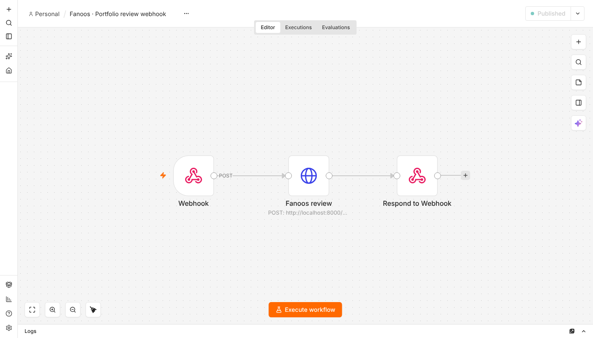
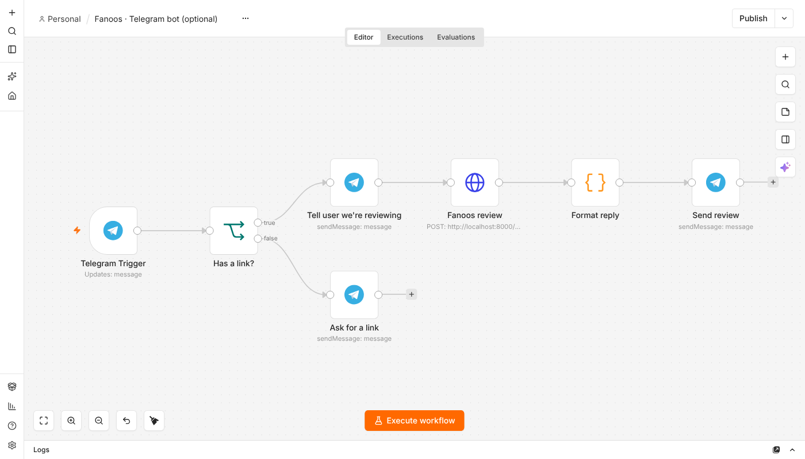

# Fanoos + n8n

Run Fanoos reviews from [n8n](https://n8n.io): a webhook any app can call, and an optional
Telegram bot that reviews a portfolio link sent in chat.

| File | What it does |
|---|---|
| [`n8n/fanoos-workflow.json`](../n8n/fanoos-workflow.json) | **Webhook** `POST /fanoos-review` → **HTTP Request** to Fanoos → **Respond to Webhook** with the review JSON |
| [`n8n/fanoos-telegram-workflow.optional.json`](../n8n/fanoos-telegram-workflow.optional.json) | *Optional.* **Telegram Trigger** → link check → Fanoos review → formatted Persian reply |

Both files were tested on n8n 2.45: imported with the CLI, through the editor's **Import from
file...** menu and through its API, published, and run end to end against a Fanoos server, on
both the test and the production webhook URLs.

## 1. Start the Fanoos server

From the `fanoos` folder, with at least one API key set (see the main README):

```bash
uvicorn server:app --port 8000
```

Check it: open <http://localhost:8000/health>. You should see `"status": "ok"` and the selected
provider.

> **n8n in Docker?** `localhost` inside the container is the container itself. In the
> **Fanoos review** node, change the URL to `http://host.docker.internal:8000/api/review`
> (Docker Desktop), or run Fanoos with `--host 0.0.0.0` and use your machine's LAN IP.

## 2. Import the workflow

1. Open n8n (usually <http://localhost:5678>) and sign in.
2. In the left sidebar, click **+** → **New workflow**. An empty canvas opens.
3. Click the **⋯** menu next to the workflow name at the top → **Import...** → **Import from file...**
4. Choose `n8n/fanoos-workflow.json`. Three nodes appear, connected left to right:
   **Webhook → Fanoos review → Respond to Webhook**.
5. Click **Save** (or press <kbd>Ctrl</kbd>/<kbd>⌘</kbd> + <kbd>S</kbd>).

With the CLI instead: `n8n import:workflow --input=n8n/fanoos-workflow.json`.



## 3. Test it

**Test URL (while editing).** Click **Execute workflow**. n8n now waits for one call on the
test URL:

```bash
curl -X POST http://localhost:5678/webhook-test/fanoos-review \
  -H "Content-Type: application/json" \
  -d '{"url": "https://your-portfolio.com", "lang": "fa"}'
```

After 30 seconds to 2 minutes the review JSON comes back, and each node on the canvas shows a
green tick and its output.

**Production URL.** Click **Publish** (top right). The webhook now runs on every call, without
the editor open:

```bash
curl -X POST http://localhost:5678/webhook/fanoos-review \
  -H "Content-Type: application/json" \
  -d '{"url": "https://your-portfolio.com", "lang": "en"}'
```

### Request and response

Send JSON with:

| Field | Required | Meaning |
|---|---|---|
| `url` | yes | Portfolio URL (`https://…`) |
| `lang` | no | `fa` (default) or `en` |
| `focus` | no | Extra request, e.g. `"Focus on the Venture Compass case study"` |

The response is the same JSON as `POST /api/review`: `verdict`, `first_impression`,
`critical_issues` (`issue` + `fix`), `quick_wins`, `next_actions`, `scores` (five criteria, 0–100),
`overall_score`, `report`, `provider`, `model` and `live_search`.

Errors keep their HTTP status and come back as
`{"error": "English message\nPersian message", "type": "…"}`. For example, a missing `url`
returns `400`, a missing API key `503`, and a provider rate limit `429`.

## 4. Optional: Telegram bot

This workflow replies to any Telegram message that contains a link with a short Persian
review: the verdict, overall score, five scores, the top three critical issues with fixes, and
the next three actions. Messages without a link get a friendly prompt to send one.

1. In Telegram, talk to [@BotFather](https://t.me/BotFather), send `/newbot`, and copy the token.
2. In n8n, go to **Credentials → Add credential → Telegram API** and paste the token. Name it
   **Telegram account**.
3. Import `n8n/fanoos-telegram-workflow.optional.json` (as in step 2). Open each Telegram node
   (the trigger and the three send nodes) and select the **Telegram account** credential.
4. Telegram must be able to reach n8n over **public HTTPS**. Locally, start n8n with a tunnel,
   `n8n start --tunnel`, or put it behind a reverse proxy and set `WEBHOOK_URL`.
5. Click **Publish**, then send your bot a message such as
   `لطفاً این را بررسی کن: https://your-portfolio.com`.



What was tested without a real bot: the link check, link extraction (including a Persian comma
right after the link), the Fanoos call and the Persian message formatting all ran in n8n with
the Telegram nodes swapped for stand-ins. Sending and receiving real Telegram messages needs
your bot token.

## Troubleshooting

| Symptom | Fix |
|---|---|
| `The requested webhook "POST fanoos-review" is not registered` | Publish the workflow, or click **Execute workflow** and use the `/webhook-test/` URL |
| `ECONNREFUSED` in **Fanoos review** | The Fanoos server isn't running, or (Docker) use `host.docker.internal` |
| `503` with `No AI provider is configured` | Set `GEMINI_API_KEY` (free), `GROQ_API_KEY` or `XAI_API_KEY` before starting Fanoos |
| `429` rate limit | Free tiers have per-minute and per-day limits. Wait, or switch provider |
| `400 Private or local addresses cannot be reviewed` | Fanoos refuses internal URLs. For local testing, start it with `FANOOS_ALLOW_PRIVATE_URLS=1` |
| Request times out | Reviews can take up to 2 minutes. The workflow's HTTP timeout is 5 minutes |
